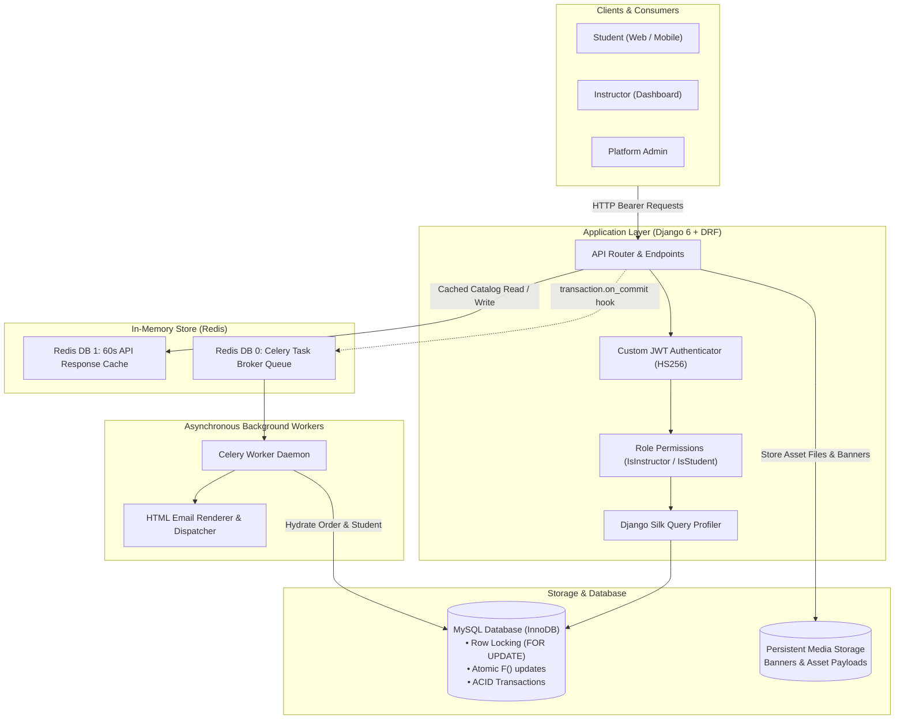
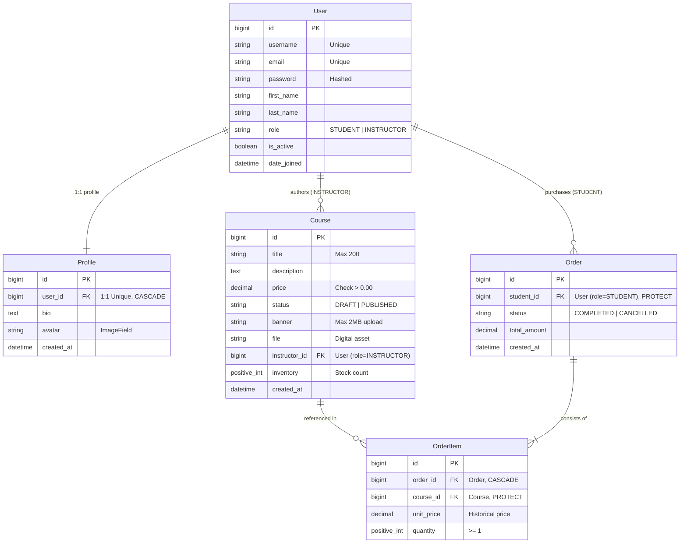
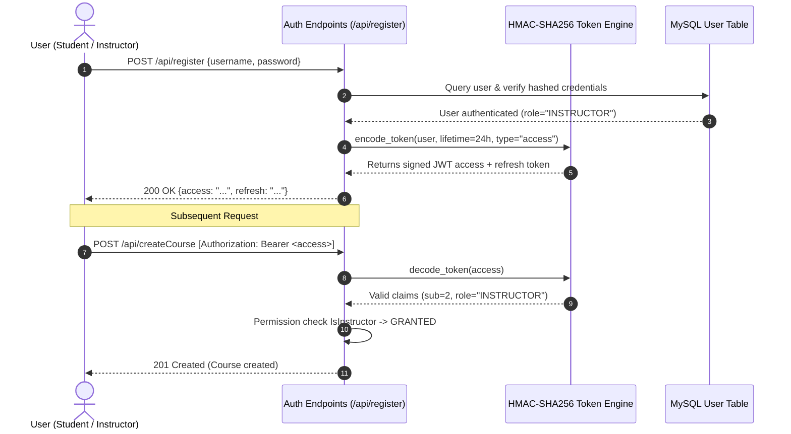
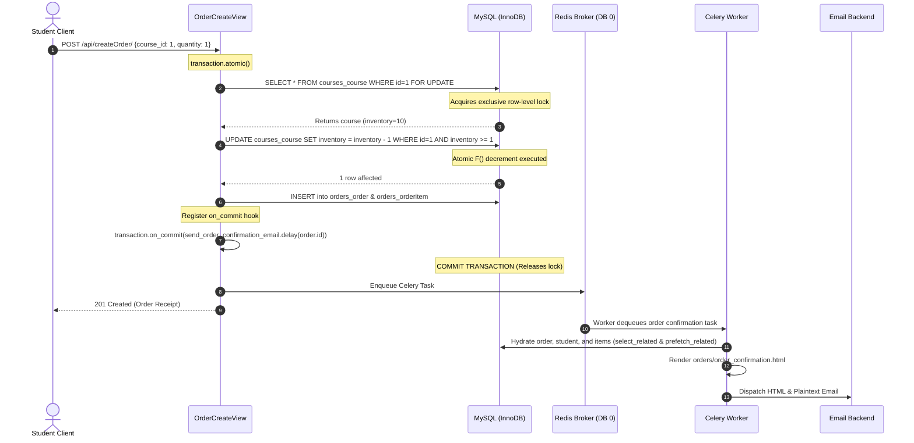

# 🎓 Digital Course & Asset Marketplace API

[](https://www.python.org/)
[](https://www.djangoproject.com/)
[](https://www.django-rest-framework.org/)
[](https://docs.celeryq.dev/)
[](https://redis.io/)
[](https://www.mysql.com/)
[](docs/VALIDATION.md)
[](LICENSE)

A production-grade, asynchronous, race-condition-safe RESTful API for a digital course and asset marketplace. Built with **Django 6**, **Django REST Framework**, **Celery**, **Redis**, and **MySQL**, the platform enables instructors to publish digital courses/assets and students to purchase them with real-time stock reservation, automated asynchronous email fulfillment, and query-optimized financial reporting.

---

## 📑 Table of Contents
- [Phase 1: The Entry Point](#phase-1-the-entry-point)
  - [Project Overview](#project-overview)
  - [Tech Stack](#tech-stack)
  - [Prerequisites & Local Setup](#prerequisites--local-setup)
  - [Docker Setup (One-Command Launch)](#docker-setup-one-command-launch)
  - [Environment Variables Reference](#environment-variables-reference)
- [Phase 2: System Architecture & Data Design](#phase-2-system-architecture--data-design)
  - [High-Level Architecture Diagram](#high-level-architecture-diagram)
  - [Database Schema (Entity Relationship Diagram)](#database-schema-entity-relationship-diagram)
  - [Key Sequence Flows](#key-sequence-flows)
- [Phase 3: API & Interface Reference](#phase-3-api--interface-reference)
  - [Quick Endpoint Directory](#quick-endpoint-directory)
  - [Postman Collection](#postman-collection)
  - [Full API Specification (`docs/API.md`)](#full-api-specification)
- [Phase 4: Engineering Decisions (The Secret Weapon)](#phase-4-engineering-decisions)
  - [Architecture Decision Records (ADRs)](#architecture-decision-records-adrs)
  - [Trade-offs & Concurrency Model](#trade-offs--concurrency-model)
  - [Edge Cases & Error Handling](#edge-cases--error-handling)
- [How Validation Was Done](#how-validation-was-done)
  - [Pytest Automated Suite](#pytest-automated-suite)
  - [Django Silk N+1 Query Verification](#django-silk-n1-query-verification)
- [Manager Evaluation Checklist](#manager-evaluation-checklist)

---

# Phase 1: The Entry Point

### Project Overview
The **Digital Course & Asset Marketplace API** is a high-performance backend system built to solve the challenges of digital asset commerce: handling concurrent checkouts without stock overselling, keeping response latencies low via intelligent caching, and decoupling email dispatch to non-blocking background workers. The system provides role-based isolation between **Instructors** (who author assets, manage drafts, and review aggregated sales revenue) and **Students** (who discover published assets, execute purchases, and receive automated receipts).

### Tech Stack
- **Backend Framework**: Python 3.12, Django 6.1, Django REST Framework (DRF) 3.18
- **Database & ORM**: MySQL 8.x / MariaDB with InnoDB engine (ACID compliant), Django ORM
- **Cache & Message Broker**: Redis 7.x (Partitioned: DB 0 for Celery, DB 1 for API HTTP response caching)
- **Asynchronous Task Queue**: Celery 5.6
- **Profiling & Observability**: Django Silk 5.6 (Query analyzer, N+1 detection, latency breakdown)
- **Testing Framework**: Pytest 9.x, pytest-django
- **Authentication**: Stateless HMAC-SHA256 JWT tokens with role claims (`STUDENT` / `INSTRUCTOR`)
- **Containerization**: Docker, Docker Compose

---

### Prerequisites & Local Setup

Run the project locally in under 5 minutes by following these terminal commands:

#### 1. Clone the Repository & Enter Workspace
```bash
git clone https://github.com/saroj580/DevTrack.git marketplace-api
cd marketplace-api
```

#### 2. Create and Activate Virtual Environment
```bash
python3.12 -m venv venv
source venv/bin/activate
```

#### 3. Install Dependencies
```bash
pip install --upgrade pip
pip install -r requirements.txt
pip install -r requirements-test.txt
```

#### 4. Configure Environment Variables
Copy the provided `.env.example` to `.env` and adjust database credentials as needed:
```bash
cp .env.example .env
```

#### 5. Prepare Database & Apply Migrations
Ensure your local MySQL or MariaDB service is active and create the database:
```bash
mysql -u root -p -e "CREATE DATABASE IF NOT EXISTS marketplace_db CHARACTER SET utf8mb4 COLLATE utf8mb4_unicode_ci;"
python manage.py migrate
```

#### 6. Create Superuser (Optional, for Django Admin & Silk)
```bash
python manage.py createsuperuser
```

#### 7. Start the Celery Worker (In a separate terminal)
```bash
source venv/bin/activate
celery -A config worker --loglevel=info
```

#### 8. Launch the Django Development Server
```bash
python manage.py runserver 127.0.0.1:8000
```
- API Root: [http://127.0.0.1:8000/api/](http://127.0.0.1:8000/api/)
- Admin Portal: [http://127.0.0.1:8000/admin/](http://127.0.0.1:8000/admin/)
- Django Silk Profiler: [http://127.0.0.1:8000/silk/](http://127.0.0.1:8000/silk/)

---

### Docker Setup (One-Command Launch)

You can spin up the entire multi-service ecosystem (Web API, Celery Worker, Redis broker & cache) using Docker Compose:

```bash
# Build and run containers in detached mode
docker compose up -d --build

# View container logs
docker compose logs -f web

# Run migrations inside the web container
docker compose exec web python manage.py migrate

# Execute tests inside the container
docker compose exec web pytest
```

---

### Environment Variables Reference

A `.env.example` template is included in the root directory. Below is the full documentation of all environment variables:

| Variable Name | Default Value | Purpose & Description |
|---|---|---|
| `DEBUG` | `1` | Enables Django debug mode. Set to `0` in production environments. |
| `ALLOWED_HOSTS` | `localhost,127.0.0.1` | Comma-delimited list of host headers the server can accept. |
| `SECRET_KEY` | *(Django standard)* | Cryptographic key used by Django for signing sessions and cookies. |
| `JWT_SECRET_KEY` | `IT_IS_A_SECRET` | Secret key used to sign and verify HMAC-SHA256 JWT tokens. |
| `DB_NAME` | `marketplace_db` | Name of the relational database. |
| `DB_USER` | `root` | Database username. |
| `DB_PASSWORD` | `1234` | Database password. |
| `DB_HOST` | `127.0.0.1` (or `db`) | Hostname of the MySQL instance (`host.docker.internal` in Docker). |
| `DB_PORT` | `3306` | Port of the MySQL database. |
| `CELERY_BROKER_URL` | `redis://127.0.0.1:6379/0` | Redis database 0 used as Celery's message broker. |
| `CELERY_RESULT_BACKEND` | `redis://127.0.0.1:6379/0` | Redis database 0 used to store Celery task completion results. |
| `REDIS_CACHE_URL` | `redis://127.0.0.1:6379/1` | Redis database 1 dedicated strictly to HTTP response caching. |
| `EMAIL_BACKEND` | `django.core.mail.backends.console.EmailBackend` | Prints emails to stdout in development. Set to SMTP in prod. |
| `DEFAULT_FROM_EMAIL` | `Marketplace <noreply@example.com>` | Sender address on order confirmation emails. |

---

# Phase 2: System Architecture & Data Design

### High-Level Architecture Diagram

The system decouples synchronous HTTP request/response loops from asynchronous background jobs using Redis and Celery, while guaranteeing transactional consistency in MySQL:



---

### Database Schema (Entity Relationship Diagram)



---

### Key Sequence Flows

#### 1. Authentication & Role-Based Authorization Lifecycle


#### 2. Atomic Order Placement & Celery Email Pipeline


---

# Phase 3: API & Interface Reference

### Quick Endpoint Directory

| HTTP Method | Route | Permission | Role Scoping / Logic |
|---|---|---|---|
| `GET` | `/api/` | AllowAny | Interactive API discovery route index |
| `POST` | `/api/createUser` | AllowAny | Registers student account & creates 1:1 profile |
| `POST` | `/api/createInstructor` | AllowAny | Registers instructor account & creates 1:1 profile |
| `POST` | `/api/register` | AllowAny | Exchanges username/password for JWT token pair |
| `POST` | `/api/token/refresh` | AllowAny | Issues fresh access token using valid refresh token |
| `GET` | `/api/getcourses/` | IsAuthenticated | Paginated, filtered, search, 60s Redis cache |
| `GET` | `/api/getCourse/<id>/` | IsAuthenticated | Course detail view (Students: published, Instructors: own) |
| `POST` | `/api/createCourse` | IsInstructor | Creates course; validates price > 0 & banner <= 2MB |
| `GET` | `/api/orders/` | IsStudent | Lists student's past orders (Prefetched items) |
| `POST` | `/api/createOrder/` | IsStudent | Atomic checkout, row-lock, F() decrement, Celery email |
| `GET` | `/api/order/<id>/` | IsStudent | Retrieves single order receipt (Tenant protected) |
| `GET` | `/api/getRevenue/` | IsInstructor | Aggregates gross revenue & counts per asset |
| `GET` | `/silk/` | Staff/Superuser | Django Silk query profiling dashboard |
| `GET/POST`| `/admin/` | Staff/Superuser | Django Admin (inlines, filters, batch-publish action) |

### Postman Collection
A complete, ready-to-test Postman collection is committed inside the repository at:
👉 **[`docs/marketplace_api.postman_collection.json`](docs/marketplace_api.postman_collection.json)**

Import this file directly into Postman or Bruno. It includes pre-configured collection variables (`baseUrl`, `studentAccessToken`, `instructorAccessToken`, `refreshToken`) and automated test scripts to capture tokens automatically upon login.

### Full API Specification
For detailed JSON schemas, sample requests, sample responses, and complete HTTP error definitions, see the dedicated reference:
👉 **[Read the Full API Documentation (`docs/API.md`)](docs/API.md)**

---

# Phase 4: Engineering Decisions

### Architecture Decision Records (ADRs)

Key architectural trade-offs are documented in detail in [`docs/ARCHITECTURE.md`](docs/ARCHITECTURE.md). Summary of core decisions:

1. **Relational Database (MySQL/PostgreSQL) vs MongoDB**:
   - *Decision*: MySQL with InnoDB transactions.
   - *Why*: Financial marketplaces require absolute ACID guarantees. Inventory checks, order creation, and line items must succeed or fail as an indivisible unit. MongoDB's document model introduces distributed transaction overhead and risks phantom stock allocations.
2. **Pessimistic Locking (`select_for_update`) + Atomic `F()` Objects**:
   - *Decision*: Lock the course row during purchase, combined with `inventory=F("inventory") - quantity` and `inventory__gte=quantity`.
   - *Why*: In flash sales, reading stock into Python memory and saving it back leads to lost updates (race condition). Using `F()` pushes the decrement to the database engine. If stock is depleted, the update affects 0 rows, rejecting the second customer with `409 Conflict`.
3. **Redis DB Isolation (DB 0 vs DB 1)**:
   - *Decision*: DB 0 is reserved for Celery task queuing; DB 1 is dedicated to Django's `cache_page` framework.
   - *Why*: Prevents cache eviction policies or `flushdb` commands on cache data from purging unconsumed background tasks.
4. **`transaction.on_commit` Celery Task Enqueueing**:
   - *Decision*: Wrap `send_order_confirmation_email.delay()` inside `transaction.on_commit()`.
   - *Why*: Celery workers process tasks concurrently. If a task is enqueued *before* the database transaction commits, the worker may query the database before the order is saved (causing a 404), or send an email for a transaction that subsequently rolls back.
5. **Zero N+1 Query Guarantee via Eager Loading**:
   - *Decision*: Mandate `select_related()` on foreign keys and `prefetch_related()` on many-to-one reverse relations.
   - *Why*: Eliminates serializer-driven query explosions, ensuring fixed O(1) query complexity.

### Trade-offs & Concurrency Model

```text
Concurrent Checkouts on Same Course (Remaining Inventory = 1)
├── Request A (Student 1) ──► Acquires FOR UPDATE Lock ──► F() Decrement ──► Inventory = 0 ──► Commits ──► 201 Created
└── Request B (Student 2) ──► Waits on Lock ──────────────► Evaluates gte=1 ──► 0 rows updated ──► 409 Conflict (Stock Depleted)
```

### Edge Cases & Error Handling

- **Race Conditions**: Prevented using database row-level locks and `F()` expressions.
- **Overselling / Stock Depletion**: Handled cleanly with HTTP `409 Conflict` (`"detail": "Insufficient course inventory."`).
- **Input Validation**: Enforced at the serializer layer (`price > 0`, `banner <= 2MB`, `quantity >= 1`).
- **Role Isolation**: Custom DRF permissions (`IsInstructor`, `IsStudent`) reject unauthorized actions with `403 Forbidden`.
- **Database Deletion Integrity**: Protected foreign keys (`on_delete=models.PROTECT`) prevent accidental deletion of users or courses linked to historical orders.

---

# How Validation Was Done

System validation was conducted across automated unit testing, database query profiling, concurrency simulation, and container health.

### Pytest Automated Suite
The automated test suite runs against an isolated SQLite test database with `LocMemCache`:

```bash
./venv/bin/pytest -v
```

```text
tests/test_assets_and_orders.py::test_unauthenticated_user_cannot_create_asset PASSED [ 33%]
tests/test_assets_and_orders.py::test_non_instructor_cannot_publish_asset PASSED [ 66%]
tests/test_assets_and_orders.py::test_creating_order_decrements_inventory PASSED [100%]
======================== 3 passed, 2 warnings in 1.35s =========================
```

- **Authentication Guard (401)**: Confirms anonymous requests to create assets fail with 401.
- **Permission Enforcement (403)**: Confirms non-instructors cannot trigger the admin `publish_selected_assets` action.
- **Inventory Concurrency & Decrement**: Tests atomic checkout and verifies inventory decreases from 5 to 3.

### Django Silk N+1 Query Verification
Using **Django Silk** at `/silk`, query execution was profiled across catalog and order endpoints:
- **`GET /api/getcourses/`**: Exactly **2 SQL queries** (1 pagination count, 1 inner join on `accounts_user`). Zero N+1 queries regardless of course count.
- **`GET /api/orders/`**: Exactly **3 SQL queries** (`orders_order`, `orders_orderitem`, and `courses_course`). Zero N+1 queries regardless of order count.
- **`GET /api/getRevenue/`**: Evaluated in a single aggregated SQL query utilizing database-level `SUM()` and `COUNT(DISTINCT)` via `annotate()` and `aggregate()`.

👉 **[Read the Full Validation Report (`docs/VALIDATION.md`)](docs/VALIDATION.md)**

---

# Manager Evaluation Checklist

This checklist maps directly to the **1-Day Project Specifications & Requirements**:

### Module 1: Models, Database & Admin
- [x] **Custom User Model**: Extended `AbstractUser` with `role` choices (`STUDENT`, `INSTRUCTOR`).
- [x] **Profile Model (1:1)**: Associated 1-to-1 `Profile` with `bio`, `avatar`, and `post_save` signal.
- [x] **Asset / Course Model**: Fields for `title`, `description`, `price`, `status` (`DRAFT`, `PUBLISHED`), `file`, `banner`, `instructor` (FK), and `inventory`.
- [x] **Order & OrderItem Models**: Transaction models linking students, courses, unit prices, and quantities.
- [x] **Custom Manager**: `CourseQuerySet.as_manager()` implementing `.published()`.
- [x] **Race-Condition Safety**: Uses `F()` objects and `select_for_update()` during inventory decrement.
- [x] **Reporting Endpoint**: Uses `annotate()` and `aggregate()` with `ExpressionWrapper` on `/api/getRevenue/`.
- [x] **Zero N+1 Queries**: Implements `select_related()` and `prefetch_related()` across views.
- [x] **Django Admin Customization**:
  - [x] `CourseAdmin`: `list_display`, `list_filter`, and `search_fields`.
  - [x] Batch-publish custom action (`publish_selected_assets`) with role check.
  - [x] `OrderAdmin`: Uses `OrderItemInline` (`admin.TabularInline`).

### Module 2: REST API, Serializers & JWT Auth
- [x] **Authentication**: JWT-based auth with access and refresh tokens.
- [x] **Course Endpoints**: Full browsing, detail, and creation mapped via clean REST endpoints.
- [x] **Order Endpoints**: Dedicated order creation and history endpoints.
- [x] **Custom Permissions**: `IsInstructor` (asset creation) and `IsStudent` (asset purchase & order review).
- [x] **Serializer Validation**:
  - [x] Price validated strictly `> 0`.
  - [x] Stock / inventory bounds enforced during order creation.
- [x] **Filtering, Search & Ordering**:
  - [x] `SearchFilter` on `title`.
  - [x] `OrderingFilter` on `price` and `created_at`.
  - [x] `CourseFilterBackend` on `status`, `price`, and `instructor`.
- [x] **Pagination**: `CoursePageNumberPagination` configured with standard page numbering.

### Module 3: Media, Celery, Caching, Testing & Docker
- [x] **File Uploads**: Instructors upload asset files and cover images (`banner`).
- [x] **Upload Validation**: Strict validation capping banner image files at **2MB**.
- [x] **Celery + Redis Background Tasks**: Asynchronous HTML order confirmation email triggered upon order creation.
- [x] **Email Fallback**: Console backend in development; HTML template with plain-text fallback.
- [x] **Caching**: Public course listing cached for **60 seconds** in Redis with `Vary: Authorization`.
- [x] **Pytest Automated Suite**:
  - [x] Fixtures in `conftest.py` for students, instructors, clients, and assets.
  - [x] Test for unauthenticated asset creation ($401$).
  - [x] Test for non-instructor publishing attempt ($403$).
  - [x] Test for inventory decrement on successful order.
- [x] **Containerization**:
  - [x] `Dockerfile` with Python 3.12 slim.
  - [x] `compose.yaml` orchestrating `web`, `redis` (with healthcheck), and `worker`.
