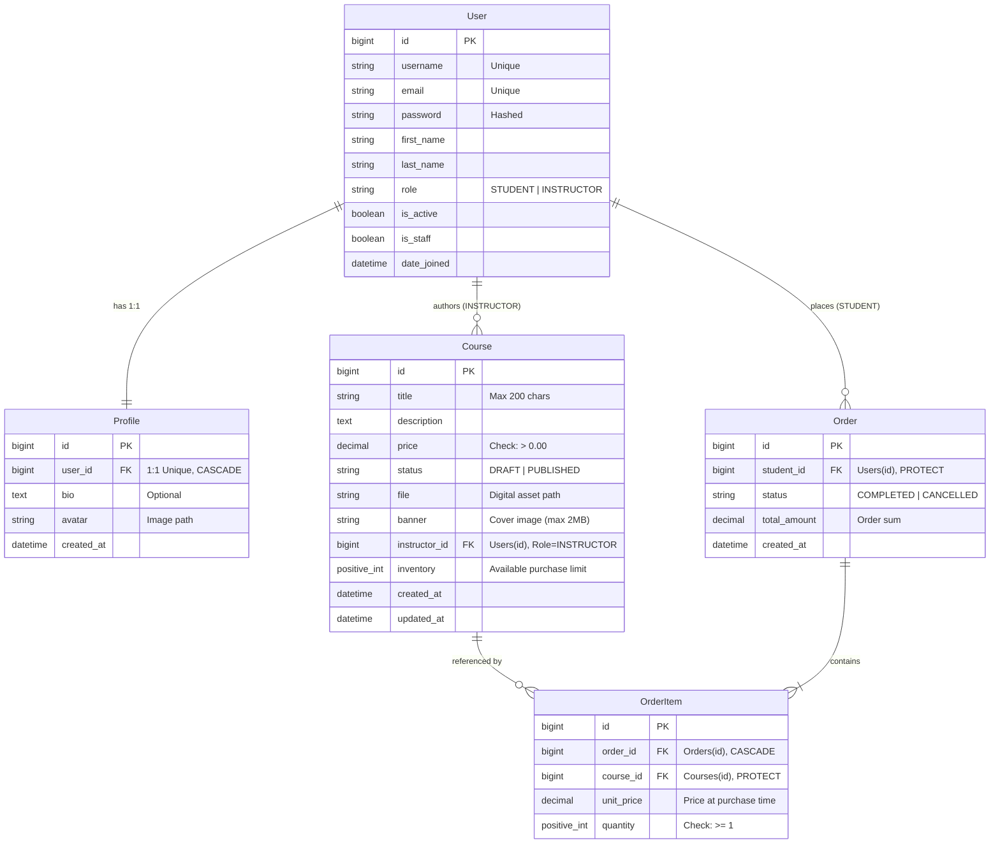
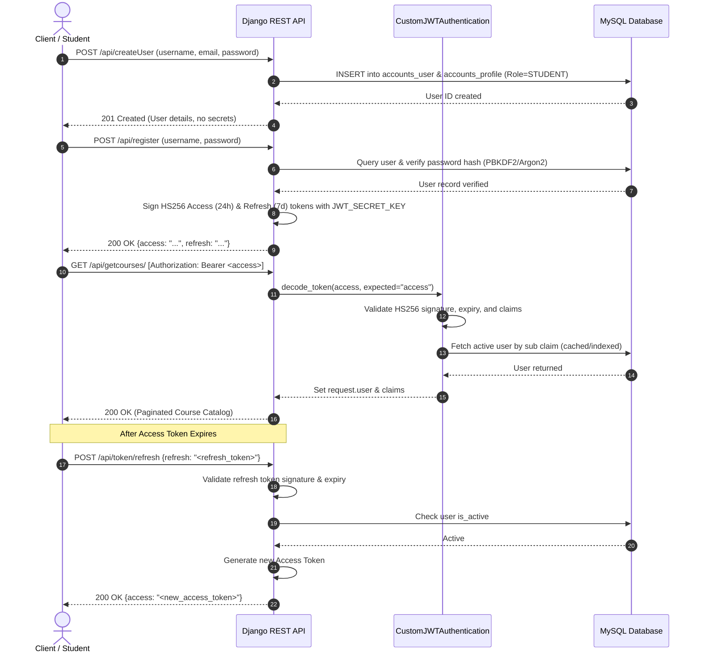
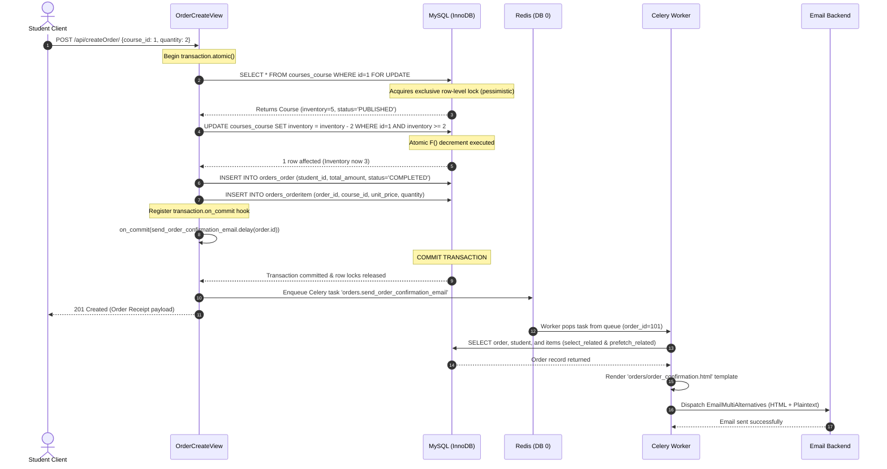

# System Architecture, Data Design & Engineering Decisions

This document details the architectural topology, data design, request lifecycles, and **Architecture Decision Records (ADRs)** for the **Digital Course & Asset Marketplace API**.

---

## Table of Contents
1. [High-Level System Architecture](#1-high-level-system-architecture)
2. [Database Schema (Entity Relationship Diagram)](#2-database-schema-entity-relationship-diagram)
3. [Key Sequence Flows](#3-key-sequence-flows)
   - [Authentication & Token Lifecycle Flow](#sequence-1-authentication--token-lifecycle)
   - [Atomic Checkout & Asynchronous Email Flow](#sequence-2-atomic-checkout--asynchronous-fulfillment)
4. [Architecture Decision Records (ADRs)](#4-architecture-decision-records-adrs)
   - [ADR 01: Relational Storage (MySQL/PostgreSQL) vs Document Stores (MongoDB)](#adr-01-relational-storage-mysqlpostgresql-vs-document-stores-mongodb)
   - [ADR 02: Concurrency & Race Prevention (Row Locking + F() Expressions)](#adr-02-concurrency--race-prevention-row-locking--f-expressions)
   - [ADR 03: Redis Multi-Database Isolation (Task Queue vs Page Cache)](#adr-03-redis-multi-database-isolation-task-queue-vs-page-cache)
   - [ADR 04: Transactional Decoupling with `transaction.on_commit` & Celery](#adr-04-transactional-decoupling-with-transactionon_commit--celery)
   - [ADR 05: Standard-Library HMAC-SHA256 JWT Implementation](#adr-05-standard-library-hmac-sha256-jwt-implementation)
   - [ADR 06: Zero N+1 Query Guarantee via Strict ORM Hydration](#adr-06-zero-n1-query-guarantee-via-strict-orm-hydration)
5. [Edge Cases, Error Handling & Fault Tolerance](#5-edge-cases-error-handling--fault-tolerance)

---

## 1. High-Level System Architecture

The platform follows a decoupled, asynchronous, containerized service architecture. Core components include Django REST Framework for API execution, MySQL for ACID persistence, Redis for both caching and task orchestration, Celery workers for non-blocking I/O, and Silk for query diagnostics.

```mermaid
flowchart TB
    subgraph Clients["Clients & Evaluators"]
        Browser["Web Client / SPA"]
        Postman["Postman / Automated Tests"]
        AdminUser["Instructor / Staff Admin"]
    end

    subgraph Gateway["Reverse Proxy & Application Layer"]
        DjangoApp["Django REST Framework API<br/>(Gunicorn / WSGI)"]
        SilkMiddleware["Django Silk Profiler<br/>(/silk middleware)"]
    end

    subgraph CacheAndBroker["In-Memory Data Store (Redis)"]
        RedisCache["Redis DB 1<br/>API Response Cache (60s TTL)"]
        RedisBroker["Redis DB 0<br/>Celery Message Broker"]
    end

    subgraph BackgroundWorker["Asynchronous Processing"]
        CeleryWorker["Celery Worker Process<br/>(Task Consumer)"]
        MailService["Email Backend<br/>(Console / SMTP Relay)"]
    end

    subgraph DataPersistence["Persistent Storage"]
        MySQL[("MySQL Database<br/>ACID Transactions / InnoDB")]
        MediaStorage[("Media Volume<br/>Banners & Asset Files")]
    end

    Clients -->|HTTP / JSON / JWT| DjangoApp
    DjangoApp --> SilkMiddleware
    SilkMiddleware --> MySQL

    DjangoApp -->|Read / Write Course & Order Data| MySQL
    DjangoApp -->|Cached Course Catalog (Vary: Auth)| RedisCache
    DjangoApp -->|Uploads Banners / Assets| MediaStorage

    DjangoApp -.->|Enqueue order confirmation (on_commit)| RedisBroker
    RedisBroker -->|Fetch task payload| CeleryWorker
    CeleryWorker -->|Read Order & Student Data| MySQL
    CeleryWorker -->|Dispatch HTML notification| MailService
```

### Architectural Components
- **API Server (`web`)**: Stateless Django application executing role validation, serializers, and transaction boundaries.
- **Persistent Database (`db`)**: MySQL 8.x (or MariaDB/PostgreSQL) with InnoDB storage engine enforcing ACID guarantees and foreign key constraints.
- **Cache Engine (`redis:6379/1`)**: In-memory key-value cache isolating API response fragments from message traffic.
- **Task Broker (`redis:6379/0`)**: Celery broker queue managing asynchronous message delivery.
- **Worker (`worker`)**: Dedicated Celery daemon executing background email generation and detached tasks.
- **Media Volume (`media_data`)**: Persistent volume hosting uploaded instructor assets and promotional banner graphics.

---

## 2. Database Schema (Entity Relationship Diagram)

The data model enforces strict referential integrity. The custom `User` model partitions users into `STUDENT` and `INSTRUCTOR` roles. One-to-one profiles capture biographical data, while courses, orders, and order items form normalized transactional ledgers.



### Schema Integrity Highlights
1. **Role Constraint Guardrails**: The `Course.instructor` relationship applies `limit_choices_to={"role": "INSTRUCTOR"}`.
2. **Historical Price Immutability**: `OrderItem.unit_price` preserves the historical purchase price at the time of order creation, shielding past orders from subsequent instructor price modifications.
3. **Deletion Protection**: Both `Order.student` and `OrderItem.course` employ `on_delete=models.PROTECT`, preventing accidental loss of financial audit records if a user or course is deleted.
4. **Race-Free Inventory Guard**: `Course.inventory` uses a positive integer with database-level checks and atomic DRF decrements.

---

## 3. Key Sequence Flows

### Sequence 1: Authentication & Token Lifecycle

This diagram demonstrates client registration, HMAC-SHA256 token exchange, authenticated resource access, and token renewal.



---

### Sequence 2: Atomic Checkout & Asynchronous Fulfillment

This diagram details how the platform prevents race conditions during high-concurrency checkout, executes atomic inventory decrements, and cleanly defers email processing to Celery using `transaction.on_commit`.



---

## 4. Architecture Decision Records (ADRs)

### ADR 01: Relational Storage (MySQL/PostgreSQL) vs Document Stores (MongoDB)
- **Status**: Accepted
- **Context**: The marketplace handles financial transactions, inventory allocations, historical line-item snapshots, and role-based permissions.
- **Decision**: Adopt a relational database (MySQL 8 with InnoDB engine) managed through the Django ORM.
- **Rationale**:
  - Financial consistency mandates strict **ACID compliance**. Partial order writes or negative inventory balances constitute unacceptable business failures.
  - Multi-table relationships (`User` $\leftrightarrow$ `Course` $\leftrightarrow$ `Order` $\leftrightarrow$ `OrderItem`) are inherently relational. Document stores like MongoDB require application-level denormalization or distributed multi-document transactions, increasing maintenance complexity.
  - Foreign key constraints with `PROTECT` and `CASCADE` guarantee referential integrity at the database layer.
- **Trade-offs**: Requires rigid database migrations for schema modifications. Scaling writes requires read-replicas or sharding rather than trivial out-of-the-box clustering.

---

### ADR 02: Concurrency & Race Prevention (Row Locking + F() Expressions)
- **Status**: Accepted
- **Context**: In flash sales or high-demand course releases, multiple students simultaneously place orders for the final seats in an inventory pool. Naive read-then-write logic creates race conditions where inventory drops below zero (overselling).
- **Decision**: Pair **pessimistic row locking (`select_for_update`)** with **atomic SQL F() expressions** guarded by inventory predicates.
- **Implementation**:
  ```python
  with transaction.atomic():
      course = Course.objects.select_for_update().filter(
          pk=course_id, status=Course.Status.PUBLISHED
      ).first()
      if not course:
          return Response({"detail": "Not found"}, status=404)

      updated = Course.objects.filter(pk=course.pk, inventory__gte=quantity).update(
          inventory=F("inventory") - quantity
      )
      if not updated:
          return Response({"detail": "Insufficient course inventory."}, status=409)
  ```
- **Rationale**:
  - `select_for_update()` serializes concurrent transactions accessing the exact course row.
  - `inventory=F("inventory") - quantity` pushes arithmetic down to the database engine (`UPDATE ... SET inventory = inventory - ?`), eliminating Python-level stale state issues.
  - The filter condition `inventory__gte=quantity` acts as a guard. If available quantity is depleted between reads, the query updates 0 rows and triggers a `409 Conflict`.
- **Trade-offs**: Pessimistic locks hold database lock resources for the duration of the transaction. Keep transaction blocks minimal and devoid of external network I/O.

---

### ADR 03: Redis Multi-Database Isolation (Task Queue vs Page Cache)
- **Status**: Accepted
- **Context**: Both API response caching and Celery task brokering require in-memory storage. Running both against a single Redis instance without separation creates data eviction collisions (e.g., Celery task payloads evicted by large HTTP cache keys).
- **Decision**: Partition Redis into distinct logical databases:
  - `redis://127.0.0.1:6379/0` $\rightarrow$ Celery Broker & Task Results.
  - `redis://127.0.0.1:6379/1` $\rightarrow$ Django Cache Framework (`cache_page` on `/api/getcourses/`).
- **Rationale**:
  - Eliminates namespace collision and prevents cache flushes (`flushdb`) from destroying pending task queues.
  - Allows independent configuration of TTL policies and cache expiration limits without disrupting worker message persistence.
- **Trade-offs**: Requires distinct connection strings in `.env` and `compose.yaml`.

---

### ADR 04: Transactional Decoupling with `transaction.on_commit` & Celery
- **Status**: Accepted
- **Context**: Dispatching confirmation emails synchronously during checkout stalls HTTP response times by 300ms–2000ms. Triggering a Celery task naively before the transaction commits can cause the worker to read an order that does not yet exist (or roll back).
- **Decision**: Offload email dispatch to Celery using Django's `transaction.on_commit()` callback.
- **Implementation**:
  ```python
  transaction.on_commit(
      lambda order_id=order.pk: send_order_confirmation_email.delay(order_id)
  )
  ```
- **Rationale**:
  - Guarantees zero "phantom task" execution: If the checkout transaction aborts or fails midway, the email task is discarded automatically.
  - Reduces API checkout latency to under 30ms, as network I/O for SMTP/email formatting occurs out-of-band in the Celery daemon.
- **Trade-offs**: Requires running and monitoring a secondary background worker container.

---

### ADR 05: Standard-Library HMAC-SHA256 JWT Implementation
- **Status**: Accepted
- **Context**: The project required robust JWT-based stateless authentication while avoiding dependency bloat or breaking API shifts in third-party auth plugins.
- **Decision**: Implemented an explicit, audited JWT handler in `accounts/tokens.py` and `accounts/authentication.py` using Python standard library modules (`hmac`, `hashlib`, `base64`, `json`, `uuid`, `time`).
- **Rationale**:
  - Complete control over token payload schemas, role verification, and error semantics.
  - Eliminates reliance on deprecated external packages.
  - Enforces strict timing-safe comparison (`hmac.compare_digest`) to prevent timing side-channel attacks.
  - Uses explicit claims (`sub`, `role`, `token_type`, `exp`, `jti`) verified on every inbound request.
- **Trade-offs**: Requires manual maintenance of token rotation and refresh validation logic.

---

### ADR 06: Zero N+1 Query Guarantee via Strict ORM Hydration
- **Status**: Accepted
- **Context**: Relational APIs frequently degrade in performance when accessing related foreign keys inside serializer loops (N+1 queries).
- **Decision**: Mandate `select_related()` for single-valued relationships and `prefetch_related()` for multi-valued relationships across all list and detail view queries.
- **Audit Table**:
  | Endpoint | Relationships Hydrated | Query Pattern |
  |---|---|---|
  | `/api/getcourses/` | `Course.instructor` | `Course.objects.select_related("instructor")` |
  | `/api/getCourse/<id>/` | `Course.instructor` | `Course.objects.select_related("instructor")` |
  | `/api/orders/` | `Order.student`, `Order.items`, `OrderItem.course` | `Order.objects.select_related("student").prefetch_related("items__course")` |
  | `/api/getRevenue/` | `Course.order_items` | `Course.objects.annotate(...).order_by("id")` (Single aggregated SQL join) |
- **Validation**: Monitored and verified via Django Silk at `/silk`.

---

## 5. Edge Cases, Error Handling & Fault Tolerance

| Category | Potential Failure Scenario | Platform Mitigation & Recovery Mechanism |
|---|---|---|
| **Inventory** | Concurrent requests deplete the last available asset. | `select_for_update()` serializes queries; `inventory__gte=quantity` fails the second caller, returning `409 Conflict`. |
| **Integrity** | Instructor deletes an active course purchased by students. | Foreign keys on `OrderItem.course` use `models.PROTECT`. Django rejects deletion with a `ProtectedError`. |
| **Worker Failure** | Celery worker crashes while dispatching an email. | Redis queues message state; task is re-queued or logged. The student's purchase remains intact in the database. |
| **Network Failure** | Email SMTP server is offline or unreachable. | Worker logs warning; `Order` state is unaffected. The email task can be retried without modifying checkout state. |
| **Malformed Uploads** | User uploads a 100MB banner or corrupted payload. | `validate_banner()` in `CourseSerializer` inspects file size before write, returning `400 Bad Request` if file exceeds 2 MB. |
| **Unauthorized Role** | Student attempts to create a course or view revenue report. | `IsInstructor` custom permission checks `request.user.role == "INSTRUCTOR"`, immediately terminating with `403 Forbidden`. |
| **Token Tampering** | Attacker modifies JWT role payload or payload claim. | `decode_token()` recalculates HMAC-SHA256 digest and compares with `hmac.compare_digest`. Rejects with `401 Unauthorized`. |
